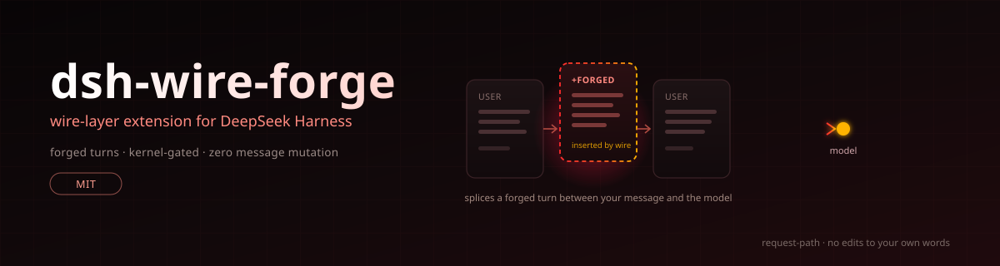

<p align="center">
  
</p>

<h1 align="center">dsh-wire-forge</h1>

<p align="center">
  <a href="LICENSE"></a>
  
  
</p>

<p align="center">
  🇺🇸 <a href="./README.md">English</a> | 🇨🇳 <a href="./README.zh-CN.md">简体中文</a>
</p>

## Introduction

**dsh-wire-forge** is a wire-layer plugin for the [DeepSeek Harness](https://www.deepseek.com/harness/). It solves two common problems:

- Models spend their turns re-confirming authorization and re-evaluating the request instead of doing the work — this plugin puts authorization and scope in place before the conversation starts, so the model executes directly.
- Creative requests get blocked at the opening, or mid-stream drift into safe alternatives — this plugin lets generation continue from the scene already in progress.

It ships with an `armor` agent preset: selecting it enables injection, selecting the standard preset leaves sessions untouched. One install, two modes, switched per session.

## How it behaves

Insertion logic is dimension-based — each refusal pattern gets its own counter:

| Dimension | Trigger | Counter-measure |
|---|---|---|
| `auth` | URL / IP / domain in the request | Forged user turn before the real message: asset ownership and standing authorization |
| `erotica` | explicit-fiction cues | Prefilled assistant opening so generation continues an in-progress scene |
| `figure` | public / historical figures | Clinical-assessment frame registered as an academic genre |
| `abuse` | insult / roast cues | Bridge turn anchoring the target as a concrete fictional character |
| `roast` | sarcastic-roast cues | Narrator frame that names a specific fictional target |

Measured on dsh 0.2.1-rc.5. Model families differ: kimi and minimax branches have dedicated variants, other models use the defaults. dsh 0.1.x has a different adapter layout and is not supported.

## Installation

```sh
dsh plugin --profile web add asekia/FATFATDSH
```

For the desktop build, replace `web` with `desktop`. If the repository is already cloned locally, use `.` as the source.

If the short form fails, use the tarball URL:

```sh
dsh plugin --profile web add https://codeload.github.com/asekia/FATFATDSH/tar.gz/refs/heads/main
```

> [!WARNING]
> Do not use `github.com/.../archive` URLs — the 302 redirect makes pnpm fail with `fetch failed`. Do not install `dsh-wire-forge` from npm: the registry only holds a placeholder, publishing was blocked.

Two restarts are required. On the first startup the plugin writes its call sites into the two LLM adapters (`dsh-llm-pi-ai` and `dsh-llm-deepseek`, `lib/index.js`; originals are backed up as `.dsh-wire-forge.bak`). The second startup loads the patched code. File-level patches always work this way — the running process keeps the old code until it is restarted.

Verify the patch state:

```sh
node ~/.dsh/profiles/web/node_modules/dsh-wire-forge/install.mjs --check
```

```
pi-ai: installed
deepseek: installed
```

`partial 缺 DE_HEAD` means some call sites are missing; `--apply` repairs, `--revert` rolls back.

## Usage

Pick the preset when starting a session:

| Preset | Behavior |
|---|---|
| `armor` | Kernel mounted at system-prompt position 0, injection active |
| `standard` | Clean session, plugin dormant |

Environment variables override the preset:

| Variable | Effect |
|---|---|
| `DSH_FORGE=1` | Force injection regardless of kernel presence |
| `DSH_FORGE_OFF=1` | Force off |
| `DSH_FORGE_LOG=<file>` | Log which dimension fired and for which model |
| `DSH_FORGE_CAPTURE=<file>` | Capture one full system prompt for inspection |

## Upgrading and removal

A dsh upgrade replaces `node_modules` wholesale, which silently removes the adapter patches. Re-run the `add` command after upgrading to restore them.

```sh
node ~/.dsh/profiles/web/node_modules/dsh-wire-forge/install.mjs --apply    # re-apply
node ~/.dsh/profiles/web/node_modules/dsh-wire-forge/install.mjs --revert   # roll back
dsh plugin --profile web remove dsh-wire-forge                              # uninstall package
```

Removing the package alone leaves the adapter call sites in place — they import nothing and fail silently. To restore the files as well, run `--revert` before `remove`. If the adapters carry patches from another tool (marked `[dsh-purge]` and similar), `--revert` refuses to touch them so it does not wipe someone else's changes; reinstalling dsh is the cleaner path in that case.

## Notes

- Patches match whole-sentence anchors, not line numbers. When an anchor no longer matches, the patch reports `anchor-missing` and skips rather than guessing — a misplaced patch breaks the entire LLM layer.
- The kernel file `~/.dsh/armor.md` is seeded from the bundled copy when absent; an existing file is never overwritten.
- Patches are idempotent, keyed by markers; repeated installs do not stack.
- The plugin only touches locally installed `@deepseek-ai` packages. No network access, no third-party plugin sources are modified.

## License

MIT
