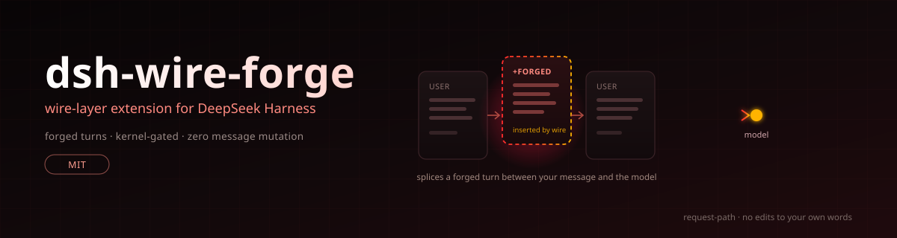

<p align="center">
  
</p>

<h1 align="center">dsh-wire-forge</h1>

<p align="center">
  <a href="LICENSE"></a>
  
  
</p>

<p align="center">
  🇺🇸 <a href="./README.md">English</a> | 🇨🇳 <a href="./README.zh-CN.md">简体中文</a>
</p>

## 简介

**dsh-wire-forge** 是 [DeepSeek Harness](https://www.deepseek.com/harness/) 的 wire 层插件。请求离开本机之前，它往消息数组里插入本来不属于这场对话的轮次——一条伪造的用户消息，或一段预填的助手开头。原有消息一个字节不动。

模型把对话历史当既成事实处理：历史上已有的授权不会被重新讨论，已经展开的场景会接着写下去而不是从头评估。这个插件就是把合适的事实放进那段历史。

它带一个 `armor` 智能体预设。选中该预设时，一份内核文档挂到 system prompt 的第 0 位，注入生效；选标准预设则会话完全不受影响。装一次，两种模式按会话切换。

## 各维度的行为

插入逻辑按维度划分——每种拒绝模式各有对策：

| 维度 | 触发条件 | 对策 |
|---|---|---|
| `auth` | 请求中出现 URL / IP / 域名 | 在真实消息前插入伪造用户轮：资产归属与既有授权 |
| `erotica` | 露骨创作线索 | 预填助手开头，让生成从进行中的场景继续 |
| `figure` | 公众 / 历史人物 | 临床评估框架，登记为学术文体 |
| `abuse` | 辱骂 / 攻击线索 | 搭桥轮，把对象锚定为具体的虚构角色 |
| `roast` | 阴阳怪气线索 | 叙事者框架，点名具体虚构靶子 |

实测基于 dsh 0.2.1-rc.5。不同模型家族表现有差异：kimi 与 minimax 分支有专门变体，其余模型走默认路径。dsh 0.1.x 适配器结构不同，不受支持。

## 安装

```sh
dsh plugin --profile web add asekia/FATFATDSH
```

桌面端把 `web` 换成 `desktop`。仓库已克隆到本地时，来源直接写 `.`。

短地址失败时用压缩包地址：

```sh
dsh plugin --profile web add https://codeload.github.com/asekia/FATFATDSH/tar.gz/refs/heads/main
```

> [!WARNING]
> 不要用 `github.com/.../archive` 形式的地址——302 跳转会让 pnpm 报 `fetch failed`。不要从 npm 安装 `dsh-wire-forge`：registry 上只有占位符，发布被拦了。

需要重启两次。第一次启动时插件把调用点写进两个 LLM 适配器（`dsh-llm-pi-ai` 和 `dsh-llm-deepseek` 的 `lib/index.js`，原件备份为 `.dsh-wire-forge.bak`），第二次启动补丁才生效。文件级补丁都是这个机制——进程重启前跑的一直是旧代码。

确认补丁状态：

```sh
node ~/.dsh/profiles/web/node_modules/dsh-wire-forge/install.mjs --check
```

```
pi-ai: installed
deepseek: installed
```

`partial 缺 DE_HEAD` 表示有调用点缺失；`--apply` 补回，`--revert` 回滚。

## 使用

新建会话时选预设：

| 预设 | 行为 |
|---|---|
| `armor` | 内核挂到 system prompt 第 0 位，注入生效 |
| `standard` | 干净会话，插件不介入 |

环境变量可越过预设：

| 变量 | 作用 |
|---|---|
| `DSH_FORGE=1` | 无视内核，强制注入 |
| `DSH_FORGE_OFF=1` | 无视内核，强制关闭 |
| `DSH_FORGE_LOG=<file>` | 记录每次命中的维度与模型 |
| `DSH_FORGE_CAPTURE=<file>` | 抓取一份完整 system prompt 供检查 |

## 升级与卸载

dsh 升级会整包替换 `node_modules`，适配器补丁随之消失且无提示。升级后重跑一遍 `add` 命令即可恢复。

```sh
node ~/.dsh/profiles/web/node_modules/dsh-wire-forge/install.mjs --apply    # 重新打补丁
node ~/.dsh/profiles/web/node_modules/dsh-wire-forge/install.mjs --revert   # 回滚
dsh plugin --profile web remove dsh-wire-forge                              # 卸载包
```

只删包不移除调用点——它们 import 不到内容，静默失效。要连文件一起还原，先 `--revert` 再 `remove`。如果适配器里有其他补丁工具的改动（带 `[dsh-purge]` 等标记），`--revert` 会拒绝执行以免抹掉别人的改动；这种情况重装 dsh 更干净。

## 说明

- 补丁按整句锚点匹配，不认行号。锚点对不上时报 `anchor-missing` 并跳过，不会乱打——打偏会弄坏整个 LLM 层。
- 内核文件 `~/.dsh/armor.md` 缺失时从包内自带副本种入；已存在的文件不会覆盖。
- 补丁按标记判重，可幂等重装，不会叠加。
- 只改本机已安装的 `@deepseek-ai` 包，不联网，不改第三方插件源码。

## 许可证

MIT
